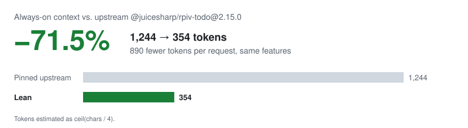

<div align="center">

# rpiv-todo-lean

**Full task tracking for Pi, with a much shorter tool prompt.**

[简体中文](https://github.com/kunkun9527/rpiv-todo-lean/blob/main/README_zh-CN.md) · Full setup: [My Lean Pi Setup](https://github.com/kunkun9527/my-lean-pi-setup)

</div>

<!-- token-benchmark:summary:start -->
<p align="center"></p>
<!-- token-benchmark:summary:end -->

A lean version of [`@juicesharp/rpiv-todo`](https://github.com/juicesharp/rpiv-mono/tree/main/packages/rpiv-todo). Task management runs on the upstream code; I only rewrote the tool prompt the model reads on every turn.

## Install

```bash
pi install npm:@ssk_dev/rpiv-todo-lean
```

Don't install it alongside upstream or another `rpiv-todo` wrapper, or the `todo` tool gets registered twice.

## Compared with upstream

**Kept**: creating, viewing, updating, deleting and clearing tasks; status changes, dependencies (`blockedBy`), metadata, batch creation (`tasks[]`), replay logs, and the task overlay UI.

**Trimmed**: the schema keeps its shape; only repeated field descriptions and long usage guidelines are gone, while the rules the model needs to use it well stay.

**Added**:

- **Fills in a missing `action`**: forgetting `action` is the model's most common mistake. It is filled in only when it can't be wrong: `subject` becomes `create`, `id` plus fields to change becomes `update`, a bare `id` becomes `get`. `delete`, `clear` and `list` are never guessed.
- **RPC plan panel**: in RPC mode, create/update/delete results end with a `- [x] step` checklist, so hosts such as codexhost (Codex Desktop) show their native plan panel. Interactive mode output is unchanged.

## Usage

The model sees a single `todo` tool with `create`, `list`, `get`, `update`, `delete` and `clear`.

For multi-step work, create the list first; mark each step `in_progress` before starting it and `completed` as soon as it is done. One step at a time, never marked all at once at the end.

## Token comparison

<!-- token-benchmark:benchmark:start -->
With only this extension enabled, what the model reads on every turn:

| Variant | Breakdown | Total |
| --- | --- | ---: |
| Lean `@ssk_dev/rpiv-todo-lean@2.15.0` | `todo` (354) | **354** |
| Upstream `@juicesharp/rpiv-todo@2.15.0` | `todo` (1,244) | **1,244** |

<sub>Method: Pi 1.4.0, each variant measured in its own temporary process with an empty working directory and configuration. Built-in tools, skills, context files, session history, user messages, other extensions, runtime UI and slash commands are not counted; `before_agent_start` additions are. Tokens are estimated as `ceil(characters / 4)`, not billed tokens.</sub>
<!-- token-benchmark:benchmark:end -->

## Development

```bash
npm ci
npm run check
```

## License

MIT. Task management comes from [`rpiv-todo`](https://github.com/juicesharp/rpiv-mono/tree/main/packages/rpiv-todo) by [@juicesharp](https://github.com/juicesharp) (MIT).
