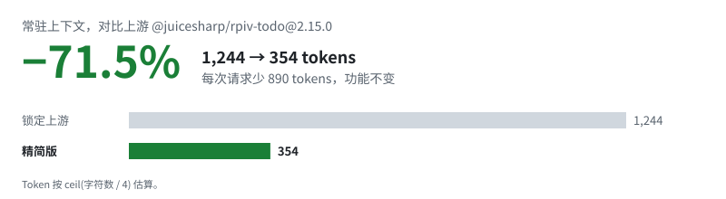

<div align="center">

# rpiv-todo-lean

**任务清单功能一项不少，工具说明短得多。**

[English](README.md) · 完整配置：[My Lean Pi Setup](https://github.com/kunkun9527/my-lean-pi-setup)

</div>

<!-- token-benchmark:summary:start -->
<p align="center"></p>
<!-- token-benchmark:summary:end -->

[`@juicesharp/rpiv-todo`](https://github.com/juicesharp/rpiv-mono/tree/main/packages/rpiv-todo) 的精简版。任务管理直接调用上游的实现，我只重写了模型每轮都要读的工具说明。

## 安装

```bash
pi install npm:@ssk_dev/rpiv-todo-lean
```

不要和上游或其他 `rpiv-todo` 包装同时安装，否则 `todo` 工具会注册两次。

## 和上游比

**保留**：创建、查看、更新、删除、清空任务；状态流转、依赖关系（`blockedBy`）、元数据、批量创建（`tasks[]`）、回放记录，以及任务浮层 UI。

**精简**：schema 结构不变，只删掉重复的字段说明和冗长的使用指南，保留模型用好它必需的规则。

**新增**：

- **补全漏写的 `action`**：模型最常犯的错是忘写 `action`。只在不会猜错时自动补上：有 `subject` 补成 `create`，有 `id` 和要改的字段补成 `update`，只有 `id` 补成 `get`。`delete`、`clear`、`list` 从不猜。
- **RPC 计划面板**：RPC 模式下，create/update/delete 的结果会附上 `- [x] 步骤` 清单，codexhost（Codex Desktop）等宿主会据此显示原生计划面板。交互模式的输出不变。

## 用法

模型只会看到一个工具 `todo`，支持 `create`、`list`、`get`、`update`、`delete`、`clear`。

做多步任务时，先建好清单；每一步开始前标成 `in_progress`，做完马上标成 `completed`。一次只推进一步，不要留到最后一起标。

## Token 对比

<!-- token-benchmark:benchmark:start -->
只启用这一个扩展时，模型每轮都会读到的内容：

| 版本 | 构成 | 合计 |
| --- | --- | ---: |
| Lean `@ssk_dev/rpiv-todo-lean@2.15.0` | `todo` (354) | **354** |
| 上游 `@juicesharp/rpiv-todo@2.15.0` | `todo` (1,244) | **1,244** |

<sub>测量方式：Pi 1.4.0，每个版本在独立的临时进程里测，工作目录和配置都是空的。不计内置工具、Skills、上下文文件、会话历史、用户消息、其他扩展、运行时 UI 和 Slash Commands；计入 `before_agent_start` 注入的内容。Token 按 `ceil(字符数 / 4)` 估算，不是实际计费值。</sub>
<!-- token-benchmark:benchmark:end -->

## 开发

```bash
npm ci
npm run check
```

## 协议与致谢

MIT。任务管理功能来自 [@juicesharp](https://github.com/juicesharp) 的 [`rpiv-todo`](https://github.com/juicesharp/rpiv-mono/tree/main/packages/rpiv-todo)（MIT）。
